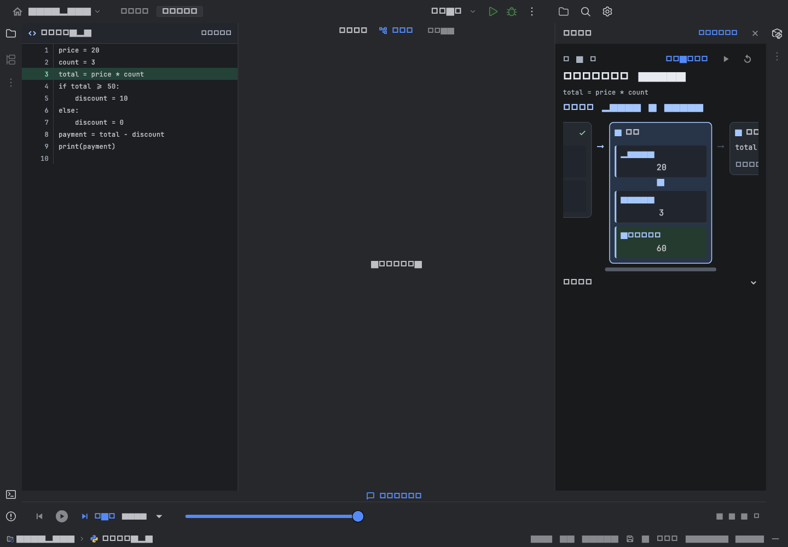

# Pyvis 见微

**把 Python 的执行过程画出来。**

Pyvis 是一款面向 Python 初学者和教学演示的图形化编辑器。你可以编写和运行代码，逐步观察变量如何变化、条件走了哪条分支、函数如何调用和返回。

**v0.1.1 预览版** · Android · macOS · Windows



## 获取 Pyvis

| 平台 | 安装或启动 | 验证状态 |
| --- | --- | --- |
| Android | 安装 `app-release.apk`。支持 Android 7.0 及以上的 arm64-v8a 和 x86_64 设备。 | 已构建并在安卓模拟器验证。 |
| macOS | 打开 `Pyvis.app`。支持 macOS 12 及以上，应用同时包含 Apple 芯片和 Intel 架构。 | 已构建并在 Apple 芯片 Mac 上运行。 |
| Windows x64 | 双击 MSI 安装，或解压便携 ZIP 后打开 `pyvis_editor.exe`。 | GitHub Actions 构建并验证两种包。 |

当前安装包由本地构建生成。Android、macOS 和 Windows 的打包流程会嵌入 CPython，使用预置示例时无需单独安装 Python。

## 第一次使用

1. 启动 Pyvis，在欢迎页点 **打开示例**，打开 `逐行运算.py`。
2. 点 **直接运行**。从编辑页运行时，页面留在编辑区，在下方控制台可以看到输出 `50`。
3. 点 **演示运行**，再点 **下一步**，观察总价计算、折扣分支和最终赋值。也可以手动打开 **代码流程图**，用时间轴回看已记录的执行过程。
4. 试着把 `count` 改为 `2`，再运行一次。输出会变成 `40`，流程会走另一条分支。

[查看全部内置示例](examples/)，还有共享列表、对象、递归和多文件调用。

## 主要功能

- **直接运行和逐步演示**。查看控制台输出，按步骤观察实际值、对象引用和调用栈。
- **代码概览和节点图**。查看条件、循环、函数和数据之间的关系，并定位到对应源码。安卓在节点图页点 **编译节点图** 生成画布，修改代码后会提示重新编译。
- **编辑和项目管理**。支持 Python 补全、运行前检查、查找替换、新建脚本，以及通过顶部项目菜单打开最近项目。
- **保存和打开执行记录**。回看某次运行时的代码和变量变化，无需再次运行程序。

安卓版欢迎页底部的 **触控操作** 提供编辑、运行和节点图手势说明。iOS 目前处于宿主工程阶段。

## 从源码构建

构建需要 Flutter 和 Python 3.12 及以上，以及相应平台的构建工具。首次构建需要下载依赖和内置运行环境。

推送 `v0.1.2` 这类版本标签会启动 `Publish Pyvis release`。工作流从标签读取版本号，并用该提交的 Git 历史提交数作为统一构建号，临时写入构建机上的 `client/pubspec.yaml`。三个平台都构建成功后，工作流自动生成发布说明，并将安装包上传到 GitHub Releases。请在上一版之后的新提交上打发布标签，让构建号随发布递增。手动从分支运行单平台工作流时使用该分支的 `pubspec.yaml` 版本，安装包可从该次运行的构建产物下载。

**Android**（Android SDK / NDK）

```sh
cd client
flutter pub get
flutter build apk --release --target-platform android-arm64,android-x64
```

产物位于 `client/build/app/outputs/flutter-apk/app-release.apk`。
本地构建默认使用 Android 调试签名。正式分发请运行 GitHub Actions 的 `Android signed APK` 工作流，并从 `Pyvis-Android` 构建产物下载已验证签名的 APK。已有调试签名版本的设备需要先备份文稿，再卸载旧版才能安装正式签名版本。

**macOS**（Xcode）

```sh
./tools/build_macos.sh
```

应用位于 `client/build/macos/Build/Products/Release/Pyvis.app`，磁盘映像位于 `client/build/macos/packages/Pyvis.dmg`。也可以运行 GitHub Actions 的 `macOS DMG` 工作流，从 `Pyvis-macOS` 构建产物下载。测试包使用 ad-hoc 签名，下载后首次打开时可能需要在「系统设置 → 隐私与安全性」确认。开发模式可在仓库根目录运行 [run_desktop.sh](tools/run_desktop.sh)。

**Windows x64**（Visual Studio C++ 桌面构建工具、WiX 6）

构建 MSI 需安装 WiX 6.0.2，并运行 `wix extension add -g WixToolset.UI.wixext/6.0.2`。在仓库根目录用 PowerShell 运行 `./tools/build_windows.ps1`，默认生成 MSI 和便携 ZIP。可用 `-Format MSI` 或 `-Format Portable` 只构建其中一种。两种包均内置 CPython，产物位于 `client/build/windows/packages/`。MSI 安装向导可选择为当前用户或所有用户安装、修改安装目录，以及是否创建桌面快捷方式。两种范围均添加开始菜单入口，为所有用户安装需要管理员权限。重新安装旧版 0.1.1 MSI 时，选择与原安装相同的范围可就地更新。GitHub Actions 的 `Pyvis-Windows-x64` 构建产物也提供两个文件。[Windows 打包脚本](tools/build_windows.ps1)

## 开发资料

Windows 的 Actions 产物 `Pyvis-Windows-x64` 包含自签测试 MSI、公开证书 `windows-test.cer` 和便携 ZIP。测试者确认来源及证书指纹后，可以在 Windows 证书管理器信任该测试证书。便携 ZIP 和公开证书都不包含私钥。

- [Flutter 客户端](client/)包含编辑器、节点画布和平台工程。[Python 内核](runtime/pyvis_runtime/)负责执行记录和代码分析。
- [Flutter 测试](client/test/)和[内核与画布测试](tests/)覆盖基础工作流。测试截图输出到 `client/build/test-artifacts/`。
- [执行与回放协议](docs/architecture.md)、[节点图开发记录](docs/comfy-handoff.md)和[功能验收记录](docs/basic-acceptance.md)记录实现与验证细节。

## 许可证

Pyvis 自有源代码采用 [MIT 许可证](LICENSE)。随项目提供的第三方代码、图标、字体和模型适用各自的许可。相关声明见[界面资源与模型](client/assets/NOTICE.md)、[节点图渲染器](client/assets/graph/vendor/NOTICE.md)和 [Python 组件](runtime/pyvis_runtime/vendor/NOTICE.md)。
