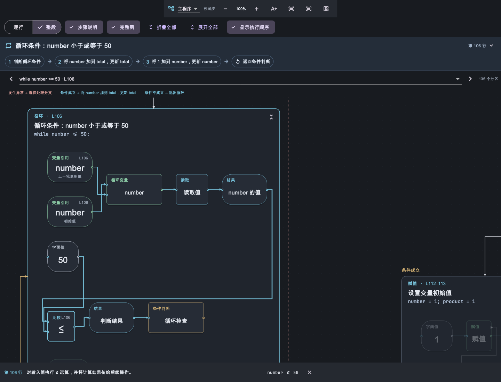

# 长菜单代码展开修复

用户截图中的 1.py 只有“说明、导入、Try 尚未细分”三块。解析器没有遍历 Try 的内部内容，导致整个主菜单及嵌套循环消失。复现副本保存在 tests/fixtures/menu_decimal.py，用户原文件不作修改。

已加入 try/except/else/finally、with 与格式化字符串的静态细分。Try 的异常入口和正常路径分离；异常按顺序匹配，else 限定正常完成，finally/with 清理先于离开当前范围。函数体解析不继承定义处的异常/清理状态。

原始图保留 863 个原子节点，整段视图有 135 个局部分区及就近引用。长依赖链按列换行，输出连续语句可共用区域但各自成行。区域带所属 try、循环与分支路径；顶部支持前后导航和搜索分区总览，正常字号定位源码行。当前区域的跨区执行和异常出口提供跳转链接。

完整图形数据始终保留，画布根据可见范围创建节点组件和线路，避免每帧对整张长图运行避障搜索。线路几何不变时直接复用；追溯关系改为邻接索引。鼠标拖动仍只移动选中节点。引用区分“初始值”“下一轮的值”，源码三个数字行号不会挤出小节点。

回归检查全部语句有节点、无 unsupported 警告、节点不重叠、异常/清理顺序、深层循环导航、搜索、真实鼠标拖动、源码行号、可见节点数量和线路缓存。另用真实 Python 跑通 1～50 求和、1～5 连乘、五次循环、逐个/批量 Decimal 求和与非法输入。全量 41 项 Python、49 项客户端测试通过，静态检查无问题。

图形仍是静态可能路径，真实运行结果从执行记录观察；推导式、except*、match 等尚未完整细分的语法继续明确标注。

实机追加修正：局部区域定位按画布宽度缩放（保留可读的下限），变量名称单行显示并预留更大的系统字体空间。新增窄画布回归，避免右侧判断被裁掉和 number 被挤成两行。
