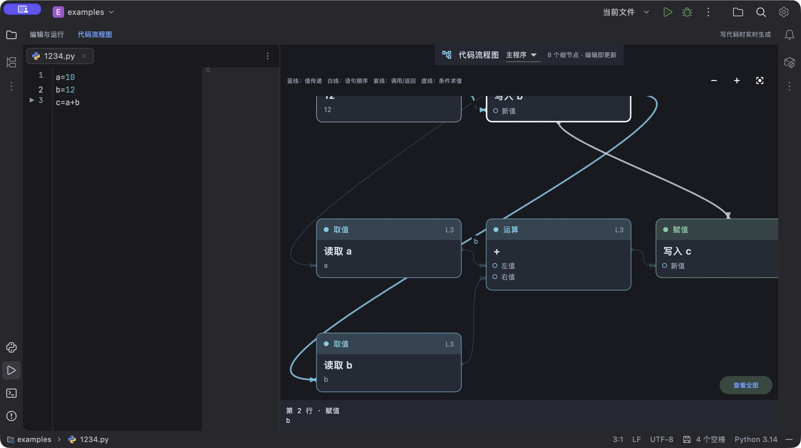
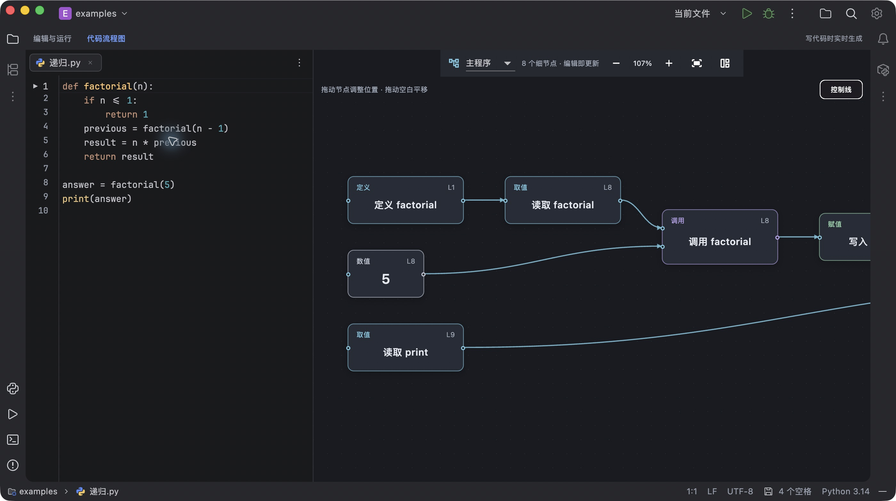
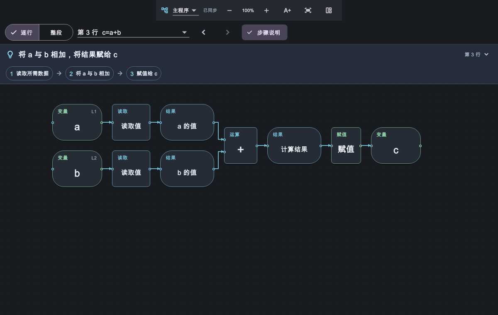

# 代码流程图可读性与自由拖动

## 1. 修改前：结构难读

来源：本轮 macOS 真实窗口，`01-before.png`。当前代码为 a=10、b=12、c=a+b。

- 三行简单代码形成纵向大图，当前视口裁掉上方节点和右侧结果。
- 从赋值到取值的蓝线向后绕，直线顺序线横穿数据关系，标签落在节点附近。
- 同一节点重复展示种类、行号、完整标题和源码，空间利用低。
- 截图可见文字在缩放后存在阅读负担；没有据此宣称全面无障碍合规。

## 2. 修改后：按数据依赖排布

保留细粒度节点，布局按数据从左到右分层；压缩节点和重复文案，控制线可切换。三行示例的默认布局宽 1164、高 258，进一步拆为十四个独立节点。点击节点追踪其来源和去向，缩放以可视区域中心为基准。

## 3. 自由拖动与行号联动

节点可单独拖动，画布空白处用于平移。连线使用节点当前位置计算端点；缩放后的鼠标距离换算到图坐标。拖动开始时定位左侧对应源码行，编辑器行号标记、光标与状态栏更新。节点自己的源码行号随卡片移动，拖动不改变源码行序。

手动位置在本次应用会话内按文件保存，切换界面和无关代码更新保留已有位置；“重新自动排布”恢复默认布局。未承诺跨应用重启保存布局。

验证：自动测试覆盖节点拖动、缩放距离、连线端点、源码定位、行号标记、修改后保留位置与重排。macOS 新版构建成功，真实窗口已确认新版节点和工具栏显示（02-after.png）。验证过程中用户切换到递归示例，因此 01 与 02 的代码、缩放状态不同，不作为同场景像素对比。03-compact-sample.png 为同样三行代码的 Flutter 实际渲染，验证十四个细节点在同一视口排布。交互测试覆盖拖动和源码行号联动；不以静态截图代替交互验证。

当前拆分层级：变量名、赋值动作、取值动作、取出的值、运算和运算结果各自独立。新版 03 渲染图已更新到十四节点；01、02 是此前真实窗口记录，保留用于追溯。

## 可读性复查：逐行阅读

默认视图现在只显示当前源码行的细粒度节点，以及来自前面的变量；“整段”保留全部节点。逐行模式以 100% 显示，基础节点文字 16–28 号，来源变量保留原行号，减少每个节点重复显示当前行号。27 项 Python 测试、36 项客户端测试通过，macOS 已重新构建并在真实窗口确认逐行、大字号视图。03 渲染图已更新为当前行的十节点视图，前面截图属于较早版本，不作为当前默认效果。

## 6. UE 蓝图方式的整段图改造

整段图按作用形成注释框式区域，每个变量、值、读取、运算、赋值仍独立显示和拖动。跨区读取以就近引用取代常驻长线；引用保存原始变量版本，选中时显示来源线和定位按钮。分支按成立/不成立分开排布，执行出口和数据端口分离。

白色区域主线保留真实控制关系。正交线路检查全部节点，拖动阻挡节点会使相关路径重新绕行；线路重叠有额外代价，优先使用平行通道。8 项路由测试及原子节点独立拖动交互检查通过。04 和 05 是相同逐行运算示例的 Flutter 实际渲染。基础编辑、执行、回放、递归回归一并通过，共 32 项 Python 和 45 项客户端测试。
